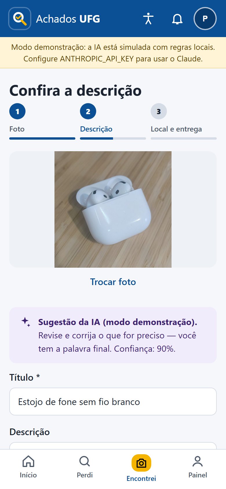
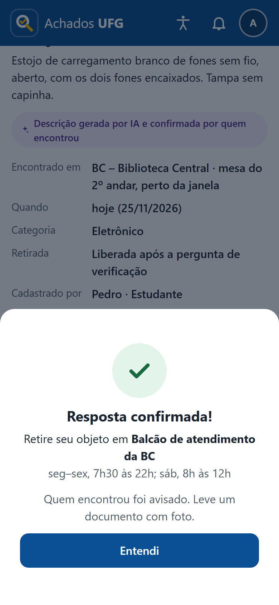

# Achados UFG — Trabalho Final de IHC

Aplicação web de **achados e perdidos com inteligência artificial** para a comunidade da Universidade Federal de Goiás.

Disciplina **Interação Humano-Computador** — Instituto de Informática (INF/UFG) · Prof. Dirson S. Campos · 2026
**Integrantes:** Beatriz Almeida Felicio · Beatriz Silva Andrade · Kamilla Jordana Regosino de Moura

### ▶ [Abrir a demonstração online](https://beatrizalmeidaf.github.io/trabalho_final_ihc/)

<p align="center">
  
  
  
  
</p>

## Como rodar localmente

```bash
git clone https://github.com/beatrizalmeidaf/trabalho_final_ihc.git
cd trabalho_final_ihc/codigo/achados-ufg
npm install
npm start          # abre em http://localhost:3000
```

Requer **Node.js 18+**. Sem configuração, a IA roda em modo demonstração. Para usar o Claude, copie `.env.example` para `.env` e preencha `ANTHROPIC_API_KEY`. Instruções completas, roteiro de demonstração e **limitações da IA** estão em [`codigo/achados-ufg/README.md`](codigo/achados-ufg/README.md).

## Conteúdo do repositório

| Pasta | Conteúdo |
|---|---|
| [`codigo/achados-ufg/`](codigo/achados-ufg/) | Código-fonte da aplicação (Node.js + HTML/CSS/JS) e README |
| [`prototipo/`](prototipo/) | Wireframes de baixa fidelidade, fluxo de tarefas e capturas de tela de todas as telas |
| [`documentos/`](documentos/) | Relatório final de IHC e documento de prompts de IA (.docx e .pdf) |
| [`slides/`](slides/) | Slides do seminário (.pptx e .pdf) |
| `.github/workflows/pages.yml` | Publicação automática da versão estática no GitHub Pages |

## Versão online × versão local

A versão do GitHub Pages roda **inteiramente no navegador**: a IA é simulada e os dados ficam no `localStorage` (use o avatar para trocar entre "quem perdeu" e "quem encontrou"; "Restaurar exemplos" volta ao início). A versão local tem servidor, dados compartilhados entre navegadores e integração real com o Claude. As duas usam o mesmo núcleo de regras (`public/compartilhado/nucleo.js`).

Fotos de exemplo: Wikimedia Commons, licenças abertas — ver [`CREDITOS.md`](codigo/achados-ufg/public/demo-fotos/CREDITOS.md).
