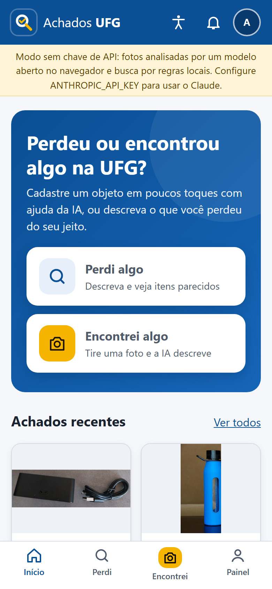
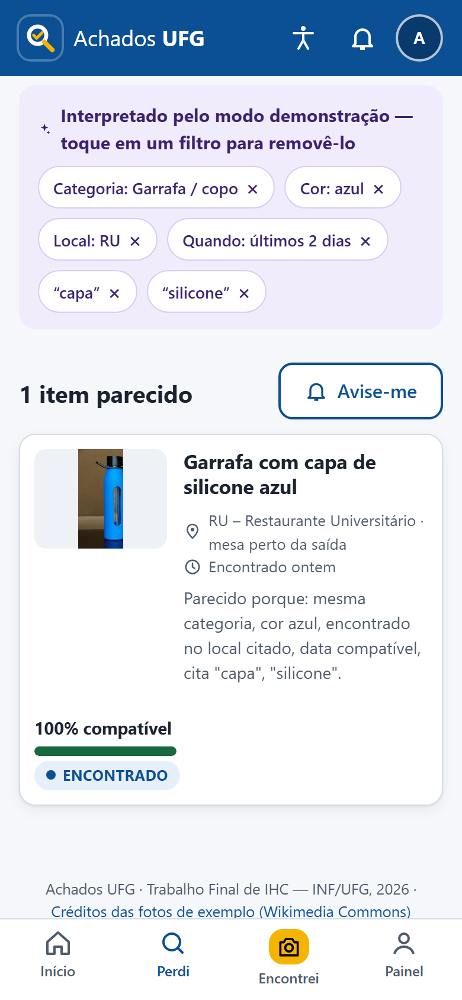

# Achados UFG — Trabalho Final de IHC

Aplicação web de **achados e perdidos com inteligência artificial** para a comunidade da Universidade Federal de Goiás.

Disciplina **Interação Humano-Computador** — Instituto de Informática (INF/UFG) · Prof. Dirson S. Campos · 2026
**Integrantes:** Beatriz Almeida Felicio · Beatriz Silva Andrade · Kamilla Jordana Regosino de Moura

### ▶ [Abrir a demonstração online](https://beatrizalmeidaf.github.io/trabalho_final_ihc/)

<p align="center">
  
  
  
  
</p>

## Como rodar localmente

```bash
git clone https://github.com/beatrizalmeidaf/trabalho_final_ihc.git
cd trabalho_final_ihc/codigo/achados-ufg
npm install
npm start          # abre em http://localhost:3000
```

Requer **Node.js 18+**. Sem configuração, as fotos são analisadas por um modelo de IA aberto que roda no navegador. Para usar o Claude, copie `.env.example` para `.env` e preencha `ANTHROPIC_API_KEY`. Instruções completas, roteiro de demonstração e **limitações da IA** estão em [`codigo/achados-ufg/README.md`](codigo/achados-ufg/README.md).

## Conteúdo do repositório

| Pasta | Conteúdo |
|---|---|
| [`codigo/achados-ufg/`](codigo/achados-ufg/) | Código-fonte da aplicação (Node.js + HTML/CSS/JS) e README |
| [`docs/`](docs/) | Relatório final de IHC, documento de prompts de IA, slides do seminário (.pptx) e definição do projeto |
| [`prototipo/`](prototipo/) | Wireframes de baixa fidelidade, fluxo de tarefas e capturas de tela de todas as telas |
| `.github/workflows/pages.yml` | Publicação automática da versão estática no GitHub Pages |

## Versão online × versão local

A versão do GitHub Pages roda **inteiramente no navegador**: as fotos são analisadas por um **modelo de IA aberto (CLIP) que roda no próprio navegador** (download de ~90 MB na primeira vez), e a busca e a verificação usam regras locais. **Os dados ficam no `localStorage` de cada navegador — outras pessoas não veem o que você cadastra.** Para simular os dois lados, troque de usuário no avatar; "Restaurar exemplos" volta ao início.

A versão local tem servidor (dados compartilhados por quem acessa o mesmo servidor) e integração com o Claude quando há `ANTHROPIC_API_KEY`. As duas usam o mesmo núcleo de regras (`public/compartilhado/nucleo.js`).

Fotos de exemplo: Wikimedia Commons, licenças abertas — ver [`CREDITOS.md`](codigo/achados-ufg/public/demo-fotos/CREDITOS.md).
